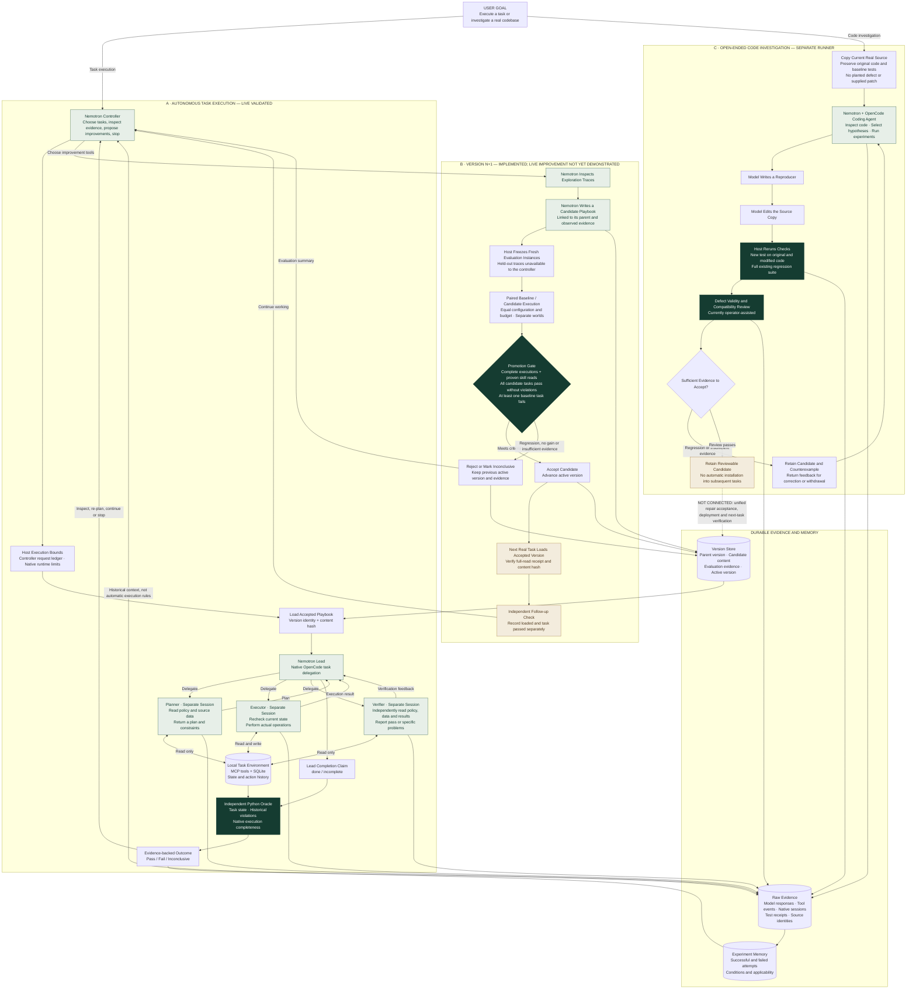

# Recursive Lab — Core Architecture

Nemotron chooses actions. Native tools execute them. Independent checks determine the outcome. Evidence and version history are retained.

**Status boundaries:** Path A has a verified live native-team run. Path B is implemented with offline tests, but a live N→N+1 improvement has not been demonstrated. Path C uses a separate coding-agent runner and operator-assisted compatibility review; it does not automatically deploy repairs.

Solid arrows show implemented interactions. The dashed arrow marks an integration that is not connected. Memory retains failures; it does not turn unverified changes into accepted execution rules.
