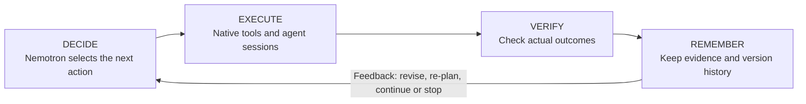
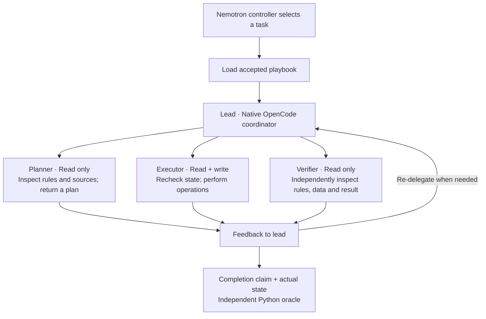
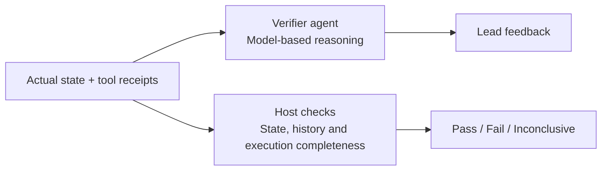
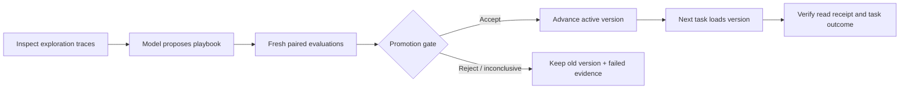
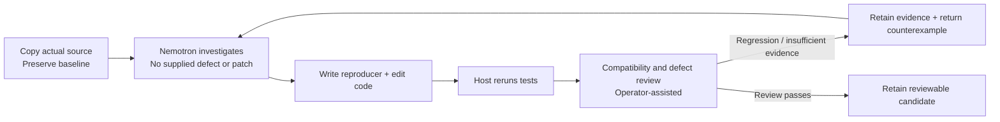

# Recursive Lab — Architecture

**The model chooses the work. Tools execute it. Verification decides what counts.**

## High-level loop

| Nemotron owns | Our framework owns |
|---|---|
| Planning, tool selection, execution and proposed improvements | Execution bounds, evidence capture, outcome checks and version gates |

**Current boundaries:** native team execution has a verified live run. Code investigation uses a separate runner with operator-assisted compatibility review. A successful live N→N+1 improvement has not yet been demonstrated.

## Low-level details

Expand only the part you want to inspect.

<strong>1. Execution team — planner, executor and verifier</strong>

All roles use Nemotron on Crusoe. These are actual native child sessions, not one response pretending to contain three agents. They access a local MCP / SQLite task environment. The lead can re-delegate after feedback.

A live rehearsal completed in **67.66 seconds**, with all three roles observed and no violations. This is one local case, not a latency guarantee or general benchmark.

<strong>2. Verification — model reasoning versus host checks</strong>

The verifier agent can be wrong. Its conclusion does not replace the host oracle. Code experiments separately run a reproducer on original and modified source, then rerun the existing regression suite.

A candidate passed 43 tests but failed an additional default-parameter compatibility check. It was rejected and the counterexample returned to the model. Defect validity and compatibility review currently include an operator.

<strong>3. Memory and evolution — retaining evidence versus accepting a change</strong>

| Store | Contents | Use |
|---|---|---|
| Raw evidence | Model responses, tool events, native sessions, test receipts, source identities | Inspect and reproduce the actual run |
| Experiment memory | Successes, failures and their conditions | Inform future decisions; not automatically become execution rules |
| Version store | Parent version, candidate playbook, evaluations, active pointer | Load only the accepted version into subsequent tasks |

**Gate:** complete runs, matching skill-read evidence, all candidate tasks pass without violations, and at least one baseline task fails. Evaluation uses equal settings and budgets with separate task worlds. Hidden evaluation traces are not returned to the controller. Loading and succeeding on the next task are separate checks.

**Status:** implemented and offline-tested; live improvement through the full chain is not yet demonstrated. Two fresh instances of one task family do not establish broad generalization.

<strong>4. Open-ended code investigation — a separate experimental runner</strong>

This coding-agent path does not automatically install repairs into subsequent agents. Connecting repair acceptance, deployment and next-task verification remains unfinished.

[Full connection diagram](CORE-FLOW-FULL.md) · [Technical architecture](ARCHITECTURE.md) · [Interactive presentation source](architecture.html)
